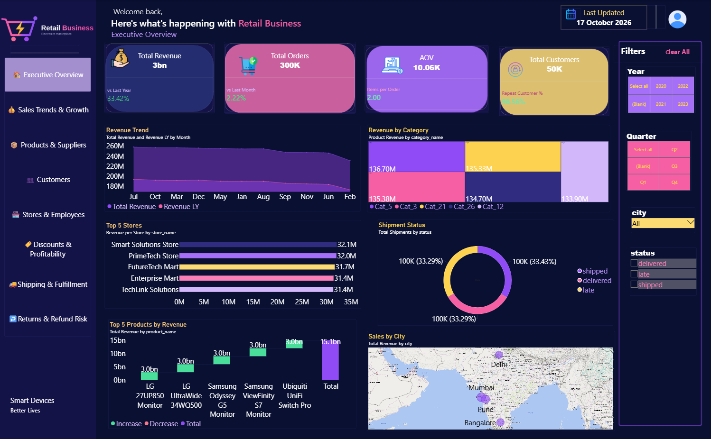
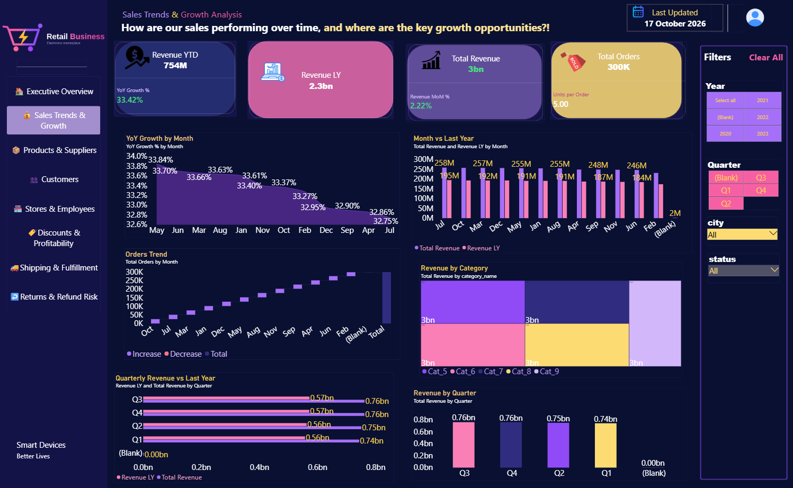
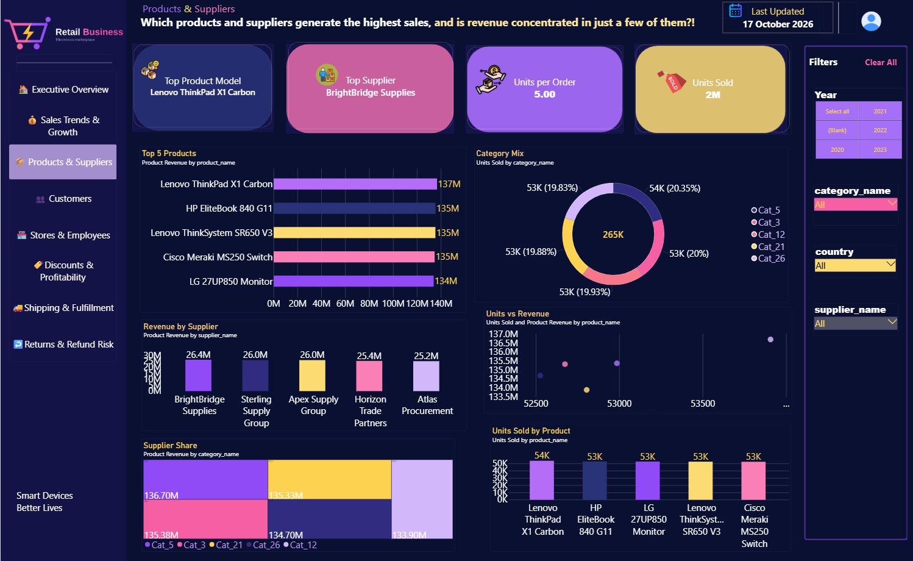
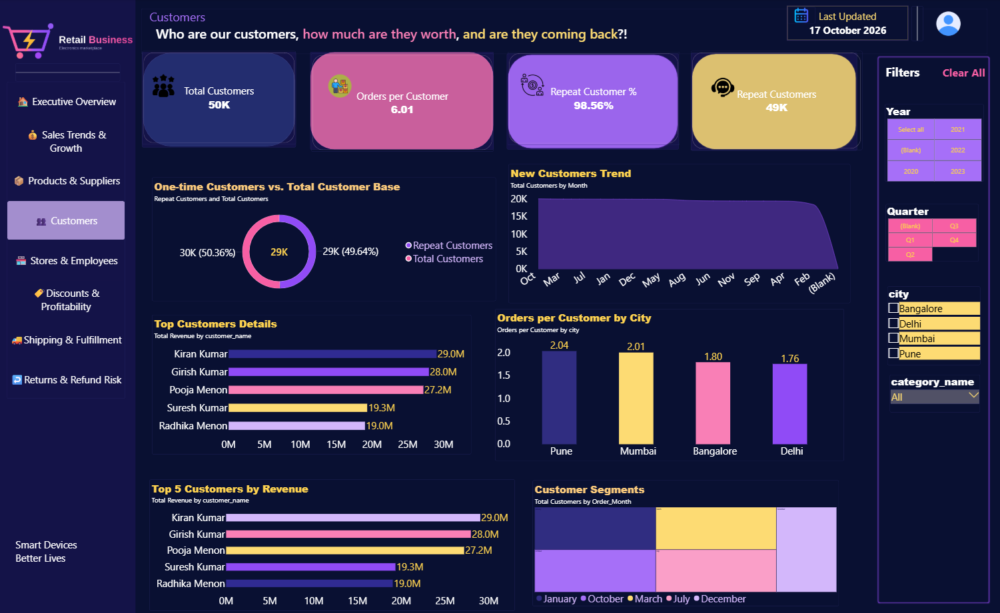
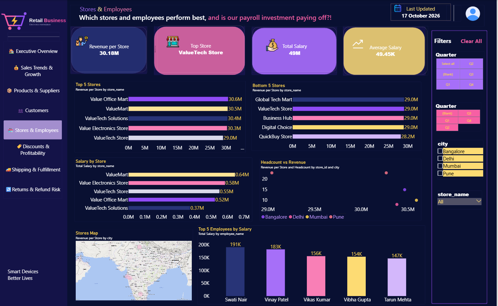
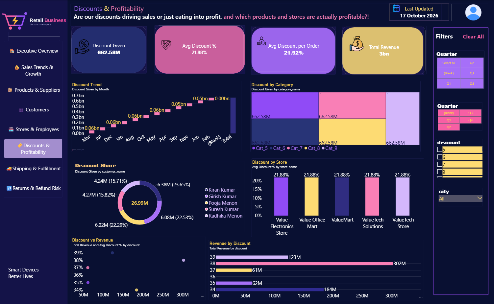
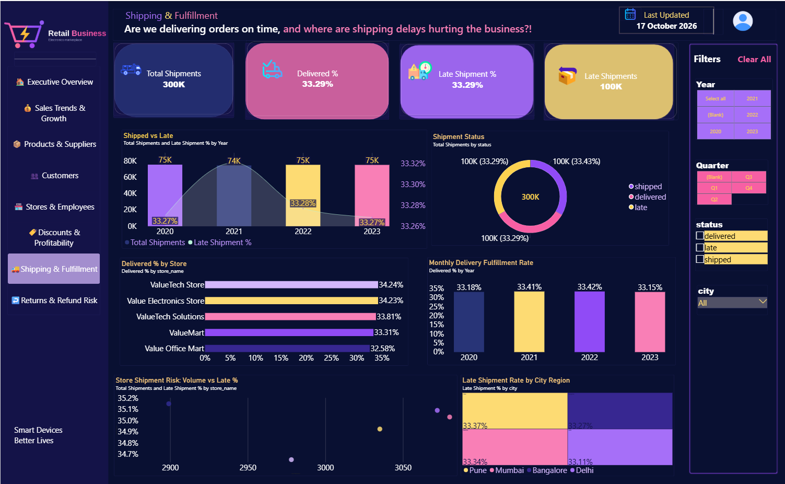
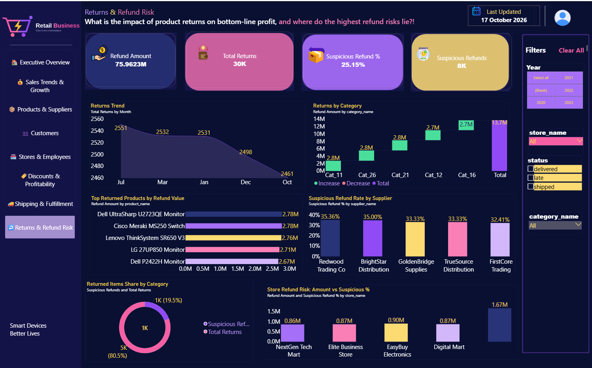

# Retail Business Dashboard

> **Note:** This project was built on a public dataset for practice and portfolio purposes.

An 8-page interactive Power BI dashboard built on a public electronics retail dataset, covering sales, products, customers, stores, discounts, shipping, and returns.

## Key Metrics
- Total Revenue: 3bn (+33.42% vs last year)
- Total Orders: 300K | Total Customers: 50K
- Average Order Value (AOV): 10.06K
- Repeat Customer Rate: 98.56%
- Total Discounts Given: 662.58M (avg discount 21.88%)
- Shipments: 300K (about 33% delivered, 33% shipped, 33% late)
- Total Returns: 30K | Refund Amount: 75.96M | Suspicious Refunds: 8K (25.15%)

## Dashboard Pages
1. Executive Overview
2. Sales Trends & Growth
3. Products & Suppliers
4. Customers
5. Stores & Employees
6. Discounts & Profitability
7. Shipping & Fulfillment
8. Returns & Refund Risk

## Business Questions Answered
- How are sales performing over time, and where are the growth opportunities?
- Which products and suppliers generate the highest revenue?
- Who are the top customers and are they coming back?
- Which stores and employees perform best?
- Are discounts driving sales or hurting profit?
- Where are shipping delays hurting the business?
- Where are the highest refund risks?

## Screenshots

## Tools Used
Power BI, DAX, Power Query, Data Modeling
